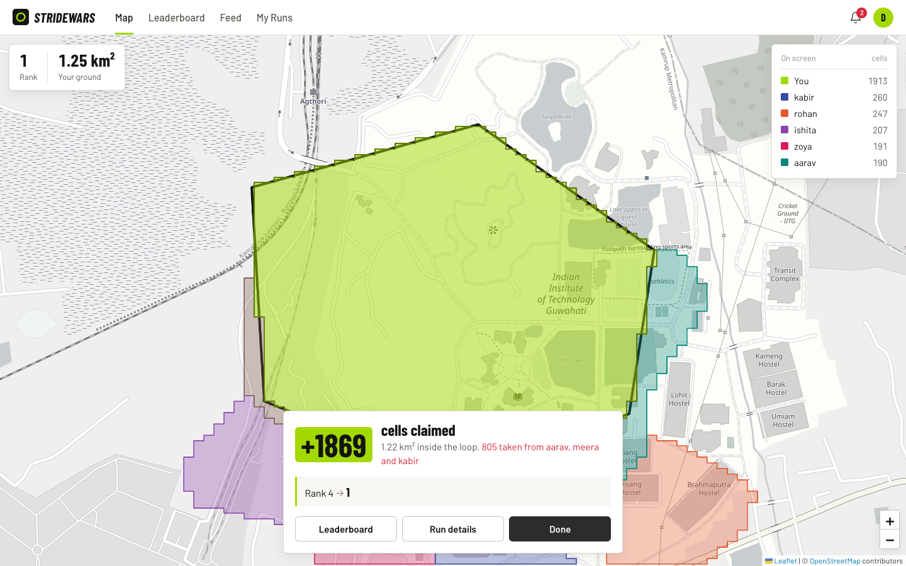
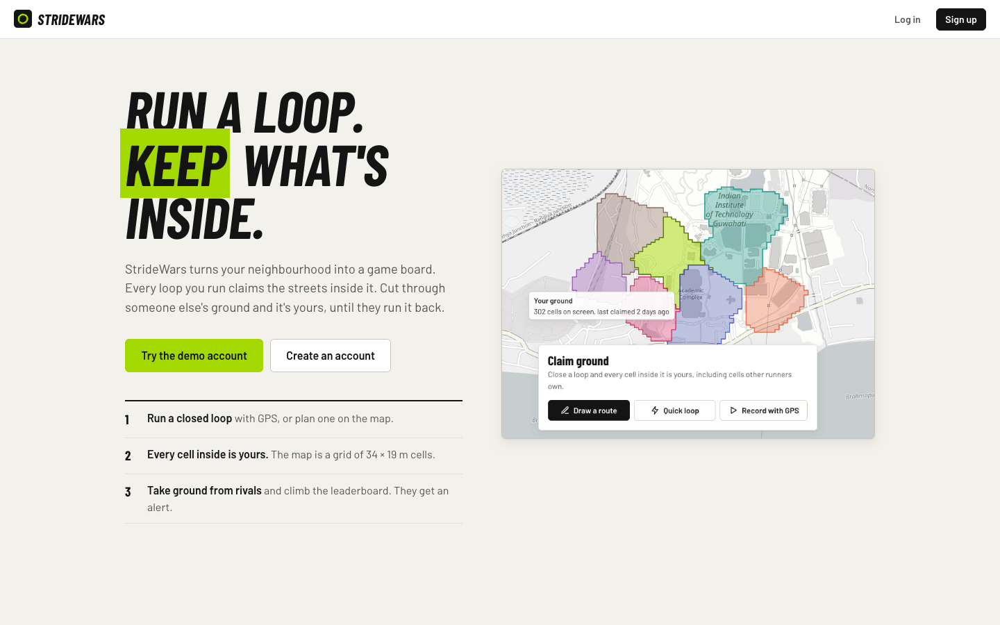
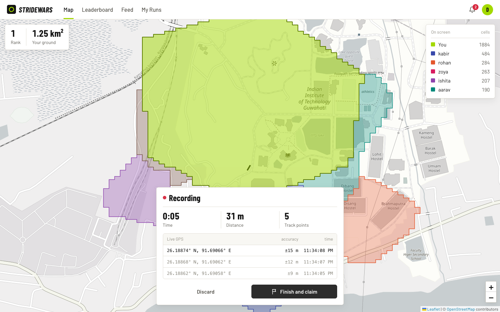
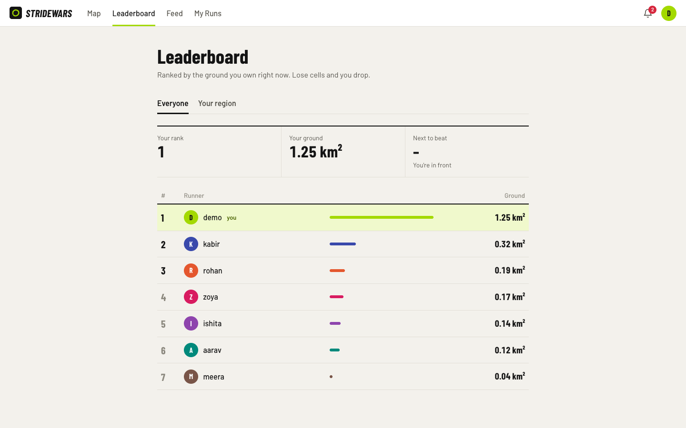

# StrideWars


StrideWars is a territory game for runners. You run a loop, and every bit of the map inside that loop becomes yours. If your loop cuts through someone else's ground, you take it from them, they get an alert, and the leaderboard shifts.

I built it to work on the backend problems that show up once lots of people write to the same data at the same time: two runners claiming the same streets in the same second, alerts that must only go out if a capture actually happened, and rankings that stay fast as the number of players grows.



## How the game works

The map is split into a grid of small cells, about 34 × 19 m each (geohash precision 8). When you finish a run, the route is closed into a loop and every cell whose centre falls inside it is assigned to you. Cells keep their owner until someone else runs a loop around them.

There are three ways to get a loop in:

- record a real run with your phone's GPS (the panel shows the latest fixes live, one every 2 seconds)
- draw a route on the map by clicking waypoints
- generate a quick loop that follows nearby roads from OpenStreetMap

Players are ranked by how much area they currently own, globally and per region. You can follow other runners and see their runs in a feed. Each runner keeps the same colour everywhere in the app, and lime is always you.

There are some basic anti-cheat checks: a run with an average pace faster than 90 s/km (car speed) or a loop larger than 5 km² is rejected.

| Landing | GPS recording | Leaderboard |
|---|---|---|
|  |  |  |

## Stack

React 18 + TypeScript + Vite on the frontend, with Leaflet for maps and plain CSS. The backend is Node + Express + TypeScript, split into modules (auth, users, runs, territories, leaderboards, social, notifications), each with its own routes, controller and service. Postgres is the source of truth, Redis holds the leaderboards and rate limits, and a small worker process sends notifications. Everything runs locally with Docker Compose, and GitHub Actions runs lint, build and tests on every push.

## What happens when you finish a run

All of this lives in [`runs.service.ts`](backend/src/modules/runs/runs.service.ts):

```
POST /api/runs  { clientRunId, points[] }
  1. validate      sort points by time, work out distance and pace, reject impossible pace
  2. close loop    join the end back to the start if they're more than 30 m apart
  3. find cells    geohash cells whose centre is inside the loop, sorted
  4. transaction   insert the run (ignored if clientRunId was already uploaded)
                   insert any cells that don't exist yet
                   lock all of them in sorted order and read their previous owners
                   hand them to the runner and log the capture history
                   queue one "you lost ground" job per runner who lost cells
  5. after commit  update the Redis leaderboard scores
```

A few decisions in there that I think are worth explaining:

- **Concurrent captures.** Each cell row is locked with `SELECT ... FOR UPDATE`, so if two runs overlap, one waits for the other and the last one to commit wins. Locks are always taken in sorted geohash order, so two transactions can't end up waiting on each other in a cycle. There's an integration test that fires three overlapping runs at once to check this.
- **Big loops.** The capture used to run three queries per cell. With small cells that turned into thousands of queries for one run, so it's now four set-based statements (`unnest`, `ANY(...)`) regardless of size. A 400-cell capture takes about 25 ms.
- **Retries.** Phones retry uploads on bad signal. Every run carries a client-generated UUID with a unique constraint on it, so a retried upload returns the original run and doesn't capture anything twice.
- **Alerts.** The notification job is inserted in the same transaction as the capture, so it only exists if the capture committed. A separate worker picks jobs up with `FOR UPDATE SKIP LOCKED`, which lets several workers run without sending the same alert twice.
- **Leaderboards.** Scores live in Redis sorted sets, so updating a score and looking up "my rank" are both O(log N). Postgres is still the source of truth, and `npm run db:reconcile` rebuilds Redis from it if the two ever drift. The top 50 is cached for 5 seconds so a burst of page loads costs one database query.
- **Feed.** Paginated with a cursor on `created_at` instead of `OFFSET`, so page 50 is as cheap as page 1.

There's more detail in [`docs/`](docs): [architecture](docs/architecture.md), [database and indexes](docs/database.md), [API](docs/api.md), [scalability](docs/scalability.md), [algorithms](docs/dsa.md) and a [decision log](docs/decisions.md).

## Project layout

```
backend/src/
  app.ts, server.ts       Express setup and entry point
  modules/<name>/         <name>.routes.ts -> <name>.controller.ts -> <name>.service.ts
  worker/index.ts         background job processor
  utils/geo.ts            haversine, polygon area, point-in-polygon, Douglas-Peucker
  scripts/seed.ts         demo world: 7 runners around the IIT Guwahati campus
  scripts/seed-scale.ts   5,000 users and 50,000 runs, for profiling
frontend/src/
  pages/                  one file per screen; MapPage is the main one
  components/map/         territory layer, run panel, map overlays
  api/                    small axios wrappers, one per backend module
```

## Running it locally

You need Node 20 or newer and Docker Desktop.

```bash
npm install
cp .env.example .env
cp backend/.env.example backend/.env
npm run setup    # starts the containers, runs migrations and seeds the demo world
```

Then open http://localhost:5173 and click "Try the demo account" (or log in as `demo@stridewars.app` / `password123`). Every seeded runner uses the same password, so you can log in as `kabir@stridewars.app` in a private window and steal ground back and forth.

<details>
<summary>Without Docker (Postgres and Redis installed locally)</summary>

```bash
# point DATABASE_URL and REDIS_URL in backend/.env at your local services
npm run migrate:up --workspace=backend
npm run db:seed --workspace=backend
npm run dev:backend                      # API on :3001
npm run worker:dev --workspace=backend   # sends the "you lost ground" alerts
npm run dev:frontend                     # app on :5173, proxies /api to :3001
```
</details>

Other commands I use a lot:

- `npm run db:seed --workspace=backend` resets everything to the demo world
- `npm run db:seed:scale --workspace=backend` loads the large dataset used for profiling
- `npm run db:reconcile --workspace=backend` rebuilds the leaderboards from Postgres
- `npm test` and `npm run test:integration` run the backend tests (integration tests need Postgres and Redis)
- `npm run test --workspace=frontend` runs the frontend tests

## What I'd do next

- Check speed between every pair of GPS points, not just the average, so a run that's half on foot and half in a car gets caught.
- Push alerts over WebSockets instead of polling for the unread count.
- Move the job queue to Redis (BullMQ) if job volume ever justifies it.
- Send map and feed reads to a read replica, and keep captures on the primary.
